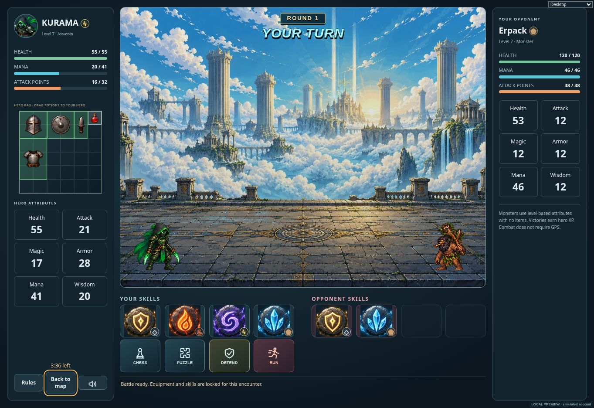
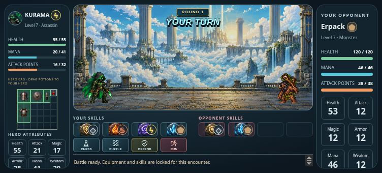

# Arcade battle layout — v0.1008

The round and turn indicator now live at the battlefield's top center. Poppins text with a dark outline and cyan/orange arcade styling shows Your turn or Enemy’s turn during combat, including the enemy's thinking and attack presentation. Harvest challenges retain their focused chess/puzzle heading.

The hero's four attack slots have a second, aligned row of four action slots: Play chess, Puzzle, Defend / end turn, and Run. Each action has an icon, compact label, accessible name and explanatory tooltip. Existing resource costs, cooldowns, turn locking and forfeits remain in use. Run moves into the side controls during a harvest, then returns to its fourth slot after the challenge closes. Its SVG has explicit intrinsic dimensions for that alternate location.

Persistent fighters and ct.js attacking poses use 45% of the previous scale. Their centers sit at 10% and 90% of battlefield width. Their ground baseline remains at 94% of battlefield height; attack effects travel between the same positions and target the smaller fighter's body. Existing character artwork and six health-state atlases are retained.

Validation: 11 renderer/health checks and four focused live UI checks passed. Coverage includes contact-time damage, cancellation, fallback effects, pose scale and ground alignment, enemy-turn presentation, four action slots, harvest return, defending and battle potion use. The production build passed. Browser QA used a simulated local account with real combat service fixtures: attacks and enemy responses played, Chess opened its board, and abandoning a harvest returned Run to its slot. Desktop, 1024 × 768 tablet, 752 × 340 and 568 × 320 landscape phone layouts were checked; root dimensions matched scroll dimensions. Opponent tooltips align inward to avoid narrow-screen horizontal overflow. No production account or wallet was used.

