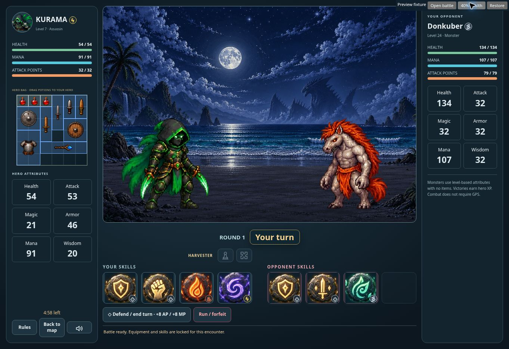
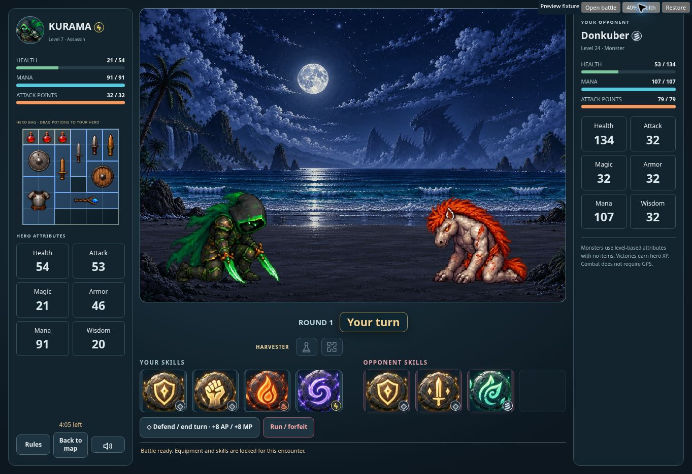
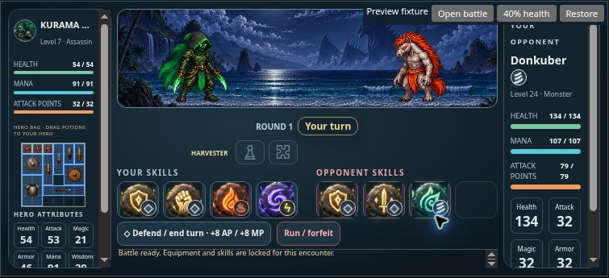

# Explorer spacing and animated battlefield — v0.1000

Based on the fetched production v0.0992 (b63e7bf), preserving its Hero Room, Skill Book, resource meter, inventory and Babaylan updates.

Nearby monsters favor road coordinates 60–190 meters from the hero, spread across available directions with 55-meter spacing where possible. Sparse-road selection relaxes to 45 then 25 meters. Positions below 40 meters are avoided when useful mapped alternatives exist; a lone available road coordinate remains usable. Duplicate coordinates are removed. The 35% nearby population remains a target, so restricted road coverage can yield fewer monsters. Other encounters remain within the 800-meter spawn area. Road collectors now sample directions and radial bands before the 512-point limit, preventing early distant ways from suppressing later nearby roads. Pins keep their existing 30-minute lifetime. The new spawn version invalidates older layouts once.

The two large static battle portraits were removed. The existing attack animation fighters now occupy one tall battlefield. Status panels, runes, harvesting and potion use remain available; potion drops and hit reactions target the animated hero. Battle opening no longer scrolls the hero panel to its footer or repeatedly steals focus during polling.

All eight heroes, ten monsters and six bosses have new four-frame health animations at 100%, 80%, 60%, 40%, 20% and zero health: 576 frames total. Living rows loop; death finishes once and holds. Hero directions support PvP through mirroring, while monsters face left. Health changes still wait for confirmed impact. Transparent source gutters are detected adaptively; every source pixel above the alpha cutoff is retained. Standing heights and ground baselines match the attack renderer; kneeling and fallen poses retain natural proportions. Image generation mode, prompts, references and final asset paths are recorded in rpg-battle-art-v1000.json.

The four existing scenes were regenerated as taller 1536 × 1024 compositions, each under 600 KB. Each battle still selects a scene once and retains it across turns. Original panorama assets remain available.

Validation: 36 geometry, animation, spawn, resource and background checks passed; five focused battle UI checks passed; nine additional API, inventory, presence and city checks passed. A real-browser fixture verified full-body fighters, a real attack and enemy reply, injured kneeling poses, and zero duplicate portrait panels. At 752 × 340, battle root dimensions matched scroll dimensions exactly; side panels remained independently scrollable. Desktop and phone proofs are in docs/images. Browser QA used a local test account and controlled location, with no production account or wallet.

