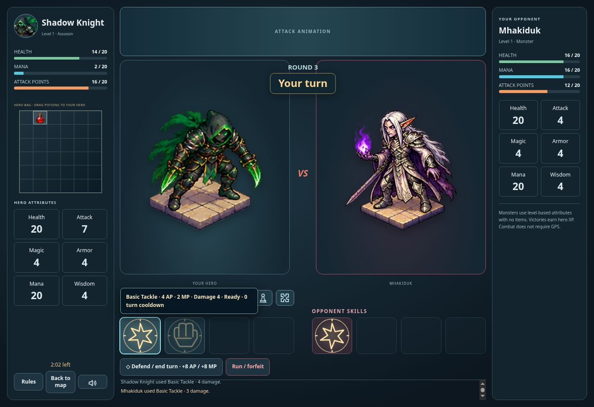

# RPG battle update v0.0648

Bag health/mana potions can be dragged onto the hero during the player's turn. Each restores up to 20 of its resource, consumes one owned bag item, and ends that turn. Server validation rejects stash items, full resources, active harvests and out-of-turn requests. PvP potion receipts reconcile inventory only after the shared battle mutation succeeds.

The top bar now hosts ct.js skill animations. Round/turn indicators sit between fighters; Back to map, Rules and sound controls are in the hero sidebar. HARVESTER labels the AP/MP controls. Mobile landscape retains the bag and compact controls.

The five supplied source PNG sheets are retained unchanged. The runtime isolates each frame on a 400×400 transparent canvas with 160-pixel-wide art (60% horizontal transparent allowance), with continuous travel and damage presentation at impact. Equipped skills are warmed and unused textures evicted. Original sandbox injury/death poses return below the healthy threshold; healthy selected hero art remains canonical.

Historical harvest results are silently acknowledged when restoring a battle. Seen results are persisted by hero and battle; exiting clears queued feedback. New harvest results still appear immediately before the enemy reply.

Validation: 43 RPG regression tests passed, including server monster/PvP potion consumption and UI drag/reopen tests. The 12 live UI tests passed again after final layout adjustments. Production build passed. Local browser QA covered desktop and 844×390 landscape, real potion dragging and ct.js animation in the top bar. Production checks verify deployment and public asset parity; authenticated production gameplay is not exercised by this release check.

