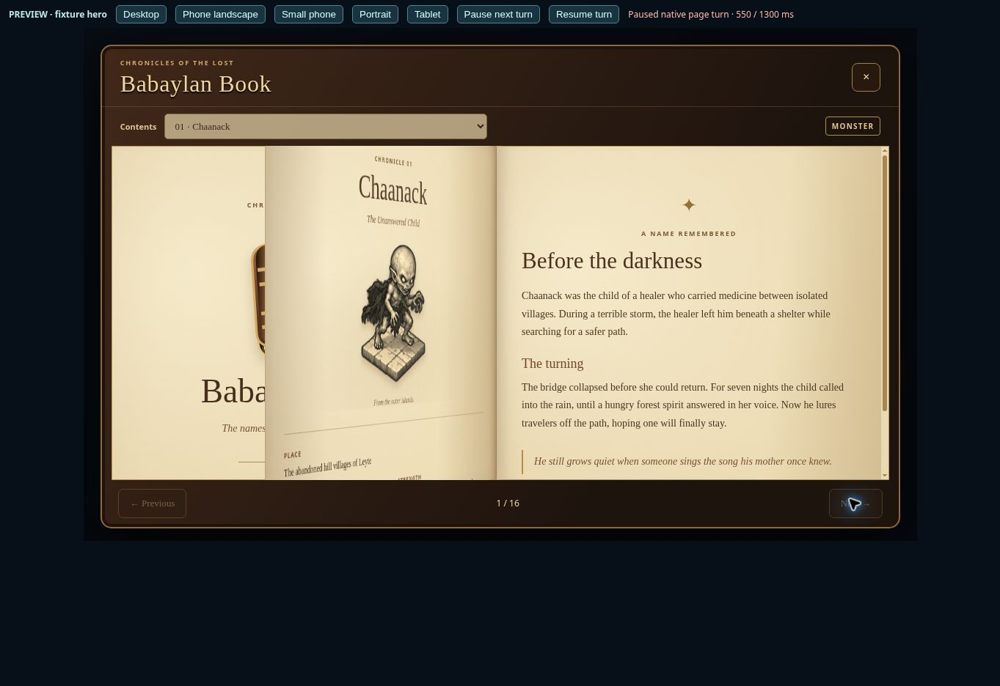
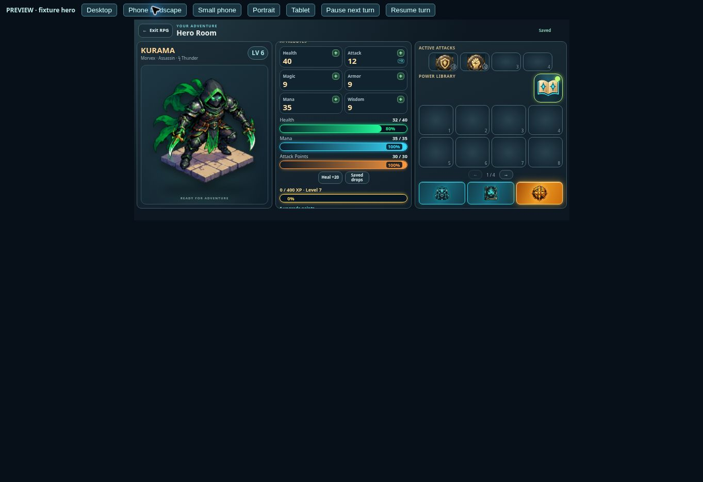

# Babaylan page turns and Attack Skill Book — v0.0976

Babaylan navigation now turns a two-sided sheet around the center spine over 1.3 seconds. The front preserves the outgoing page and the back shows the incoming page, with the matching stationary page beneath. The sheet is sized from the visible paper viewport, including scrollbar geometry, rather than half the content height. Desktop and landscape use equal-width leaves. Narrow portrait layouts turn the complete single-page viewport. Page corners, footer controls, contents, keyboard arrows and touch swipes share the same navigation path.

Navigation is locked during a turn to prevent overlapping sheets. Completion, cancellation, closing the book and resizing all remove temporary sheets and restore controls. A completion watchdog also releases a stalled animation. Reduced-motion users and browsers without Web Animations navigate immediately. Snapshot IDs are removed and temporary sheets are inert and hidden from assistive technology. Existing chronicles, sepia artwork, introduction, author credits and reading bookmarks are retained.

The Attack Skill Book now uses a dedicated cyan-and-gold open rune-book SVG. Its Power Library header separates the title/progress from the large button. The touch target ranges from 52 to 88 pixels by viewport, with the existing available-choice glow and descriptive tooltip.

Four page-turn tests and the existing skill-selection activation/cancellation check passed; production build passed. The actual built RPG page was reviewed with an in-memory fixture hero at 1136×700, 844×390, 568×320, 390×844 and 1024×768. Measured button sizes were 70, 56, 52, 60 and 77 pixels respectively, without Power Library panel overflow. Turning sheets matched the visible paper heights (454 pixels on desktop and 172 on the small landscape phone); portrait mode matched both its 342-pixel width and 647-pixel height. Normal forward/backward navigation and resizing were exercised in the browser. The motion screenshot pauses the native animation at 550 of 1300 milliseconds for inspection. No production account was modified.

