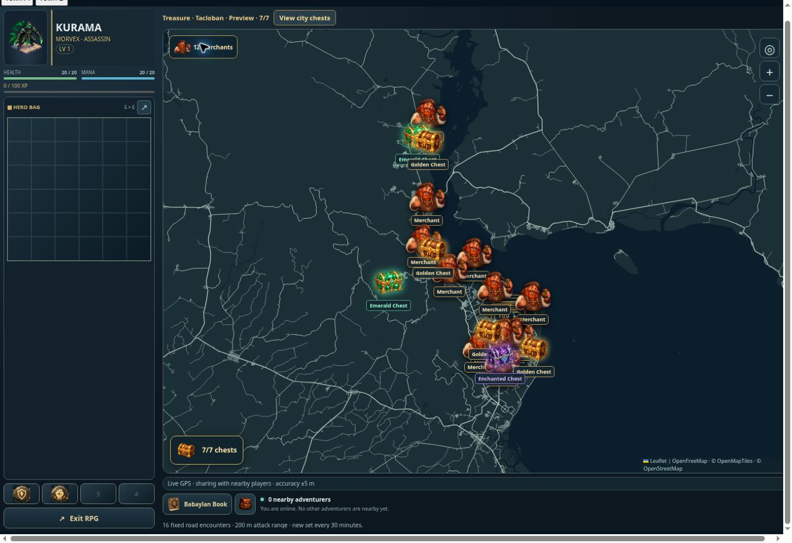

# RPG city merchants — v0.0856

Common and uncommon resale is a stable 1–3 CBG per item plus `floor(heroLevel * 0.02)`. Rare and mythic resale is 2–4 CBG plus that bonus. The base value is seeded by item identity so reopening the shop cannot reroll a quote. Epic and divine retain their existing resale formula. Quotes and completed sales use the same server calculation and existing atomic wallet/inventory RPC.

The hero-room merchant entry is removed. Explorer shows 12 shared merchant pins on cached public road points in the active city or town. Positions are deterministic for the city and day. Players need a fresh GPS fix and must be within 200 metres to trade; the server validates the current city's merchant ID. Existing stock, quantity buying, drag/drop trading and bag upgrades remain available at those merchants.

Crossing a city boundary clears old monster, chest and merchant markers, closes the pending encounter/shop, and discards delayed responses from the previous city. Monster sets and road caches are tied to the city ID. City chest and merchant data are resolved on demand for active players, without background generation for empty cities. Existing monster spawning remains 800 metres, combat interaction 200 metres, and chest opening 50 metres.

## Artwork

`public/rpg/assets/merchant/merchant-pin.webp` is a transparent 256×256 WebP generated with the built-in image generator from the existing dwarf shopkeeper reference. Prompt: friendly red-bearded dwarf merchant, head and shoulders, brown cap, braided ginger beard, warm smile, cream shirt and brown leather vest, tiny coin pouch; richly shaded chibi fantasy pixel art; readable face at GPS pin size; generous transparent margins; no background, text, border, pedestal or floor. The generated image was trimmed and resized to WebP.

## Verification

- 35 server/economy/chest/GPS checks passed, including transactional merchant SQL checks.
- 26 existing UI checks passed; six focused merchant and city-transition UI checks passed after the final client changes.
- Nine focused server checks passed after the final city-cache and encounter-selection changes.
- Browser review used the real RPG UI and service with an in-memory account and wallet fixture, actual bundled Tacloban road points, and simulated GPS. It verified 12 merchant pins, purchase/sale UI, removed hero-room shop, city switching and closing the old merchant dialog. It did not transact against a production account.

