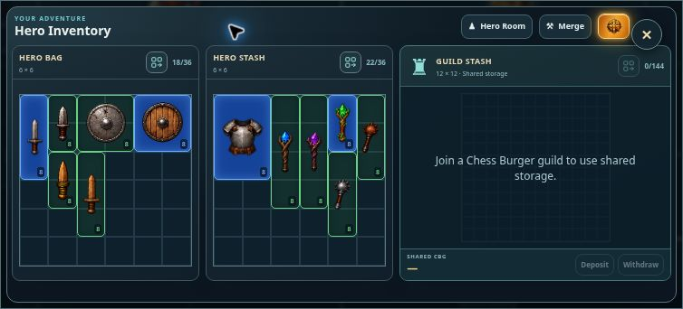

# Clean GPS Explorer — v0.1216

Continues the supplied clean-gps-explorer-v0.1216-files.zip on top of production v0.1208. The map fills the Explorer viewport. Hovering or tapping the left-edge tab reveals the hero panel, which contains chest, merchant, book, inventory and Hero Room shortcuts. Mouse leave, touch swipe and Escape dismiss the panel.

Hero Room and Hero Inventory open in a centered, responsive window over the map. GPS and existing pins remain active. Close, backdrop click, Escape and Explore World return to the same map. The popup isolates background controls, confines keyboard focus and restores focus to the edge tab on closing.

Testing exposed a delayed map reply that could overwrite equipment edits after the inventory window closed. Popup navigation epochs now reject stale background inventory application in battle polling and Explorer recovery; recovery pauses while the popup is open. Existing inventory save flushing remains in place.

Verification: all 58 live UI checks passed, including mouse/touch panel navigation, modal opening/closing, retained GPS, stale-reply inventory protection, autosave, battle impact timing, guild transfers, forging and potion merging. Production build passed. A controlled browser preview at 1363 × 936 and 752 × 340 verified the map, panel and popup layouts; mobile bag and stash grids were fully visible at 191 × 191 pixels. Browser QA used simulated GPS, map roads and inventory, without a production account.

