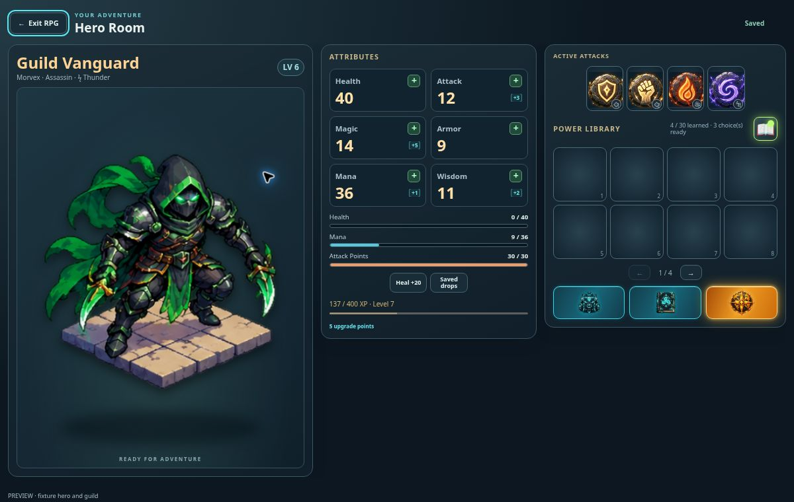

# Compact Hero Room — v0.0936

The Attributes and Power Library panels now size to their contents on larger landscape screens. Attributes start at the top of their card, spacing is tighter, and library tiles have a bounded height. Hero Inventory, Babaylan Book and Explore World remain together in one icon row at every screen size, with matching frames and the existing cyan/orange styles and focus/hover labels. Short phone screens keep the viewport-fitted layout and 44-pixel-high navigation targets. The hero portrait retains the available screen height.

Validation: three targeted UI regression checks passed for room/inventory navigation, Skill Book activation and pending guild transfers. Browser review at 1200×760, 1024×768 and 752×340 confirmed that all panels and navigation buttons remain inside the screen, with no document overflow. The preview uses a fixture hero with zero HP, partial MP, four active attacks and unspent upgrade points. Production build passed.

Hero leveling was fetched from GitHub main and is unchanged by this release. The source is `api/_rpg/src/progression.js`, with point and skill handling in `api/_rpg/src/inventory-core.js`. Maximum level is 88. Level 1 base HP/MP/AP are 20/20/20; Attack, Magic, Armor and Wisdom are 4 each. Each level adds 4 HP, 3 MP, 2 AP and 1 to each other attribute, plus one allocatable attribute point. One new skill choice is earned every two levels, up to the 30-skill catalog. The XP requirement from level L to L+1 is `100 + 35*(L-1) + 5*(L-1)^2`; reaching level 88 requires 1,218,290 total XP.

