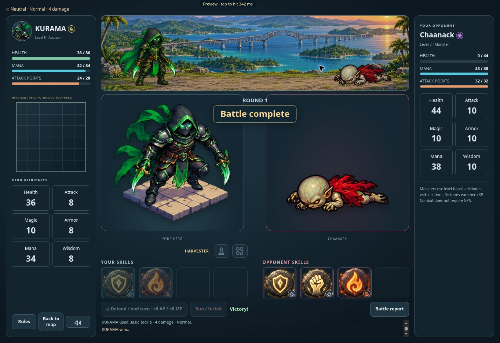

# RPG death art and attack playback — v0.0880

All 24 characters now have recreated death cutouts preserving their existing identity, costume and palette. Stone platforms, floors and edge streaks were removed using the built-in image generator. The eight heroes have left/right variants; the ten monsters and six bosses face left. Artwork references and the prompt set are recorded in rpg-death-artwork-v0880.json. Final WebPs live in public/rpg/assets/death (32 attack-aligned tiles) and its portraits directory (32 larger card images). The packer consumes a local generated-image manifest and retains transparent margins.

Banner death tiles use the same 512px canvas, 232px crop, per-character visible extent and y356 ground baseline as the attack/idle sprites. Their prone width matches the corresponding standing character's visible height; they remain naturally shorter because the character is lying down. Portrait variants fill the larger cards without the tile padding making them shrink. Existing living portraits and injury artwork remain unchanged. Death transitions still occur at the confirmed attack impact.

Attack playback runs at a minimum 14fps (six frames are about 0.43 seconds), with an 800ms completion watchdog for a stalled ticker. Character and skill atlases begin warming in the encounter preview. A sequence shares one 600ms asset preparation budget, loading its assets in parallel. If an effect is still unavailable, a 320ms rune impact preserves contact-time damage and releases the turn; the underlying request can finish caching for later use. Normal loaded effects retain the existing ct.js animation. Enemy thinking remains one to two seconds; defend/recover presentation holds were shortened. Server acknowledgement and connection latency remain additional to these client playback durations.

Verification: nine geometry/renderer checks passed, including all 32 directional death tiles and portraits, attack-scale/baseline bounds, contact-time impact, one impact per attack, stalled ticker completion, slow asset fallback, and cancellation. Five focused live UI checks passed for original hero identity/injuries, encounter opening, impact timing and enemy replies, potion turns, and harvest feedback. A real-browser controlled fixture with a simulated 50ms response measured 342ms from the request to the hit, then showed the new Chaanack death pose at the banner baseline and in the larger card. That is a controlled rendering measurement, not a production network latency guarantee. No production account or wallet was used for QA.

