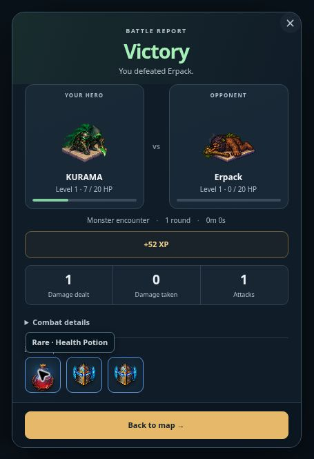

# RPG drop previews v0.0656

Battle report drops now display actual inventory item sprites in 52-pixel square tiles with rarity-colored borders. Item names and rarity appear on hover, keyboard focus or tap. Screen readers retain item names. Loot generation and delivery are unchanged.

Validation: 19 RPG battle/live UI regression tests passed. Browser QA verified three item sprite previews and the tap tooltip in the actual report. Production build passed.

