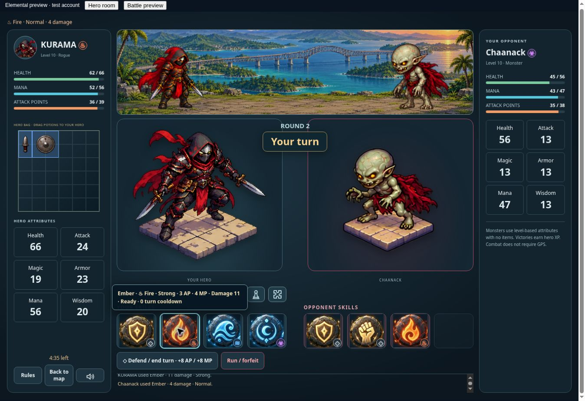

# RPG elements — v0.0864

The approved six-element system uses the reference chart: Fire and Earth beat Thunder/Toxic; Water and Air beat Earth/Fire; Thunder and Toxic beat Water/Air. Strong attacks multiply damage by 1.25; resisted attacks by 0.80; other matchups by 1. Physical skills are neutral. A skill matching the attacker's natural affinity adds 5%, excluding neutral attacks.

## Affinities

| Element | Heroes | Monsters and bosses |
| --- | --- | --- |
| Fire | Varkesh, Seraphyne | Pektu, Conchita |
| Water | Aetherion | Muraduk, Draguu |
| Earth | Draumgard, Aurex | Erpack, Windee, Punsuck |
| Thunder | Morvex | Kalaagg, Kassag |
| Air | Thalorien | Donkuber, Odeksa, Jengot |
| Toxic | Nyxlor | Chaanack, Mhakiduk, Buhokba, Baluu |

All 30 existing skills remain available. Wind skills use Air, lightning skills Thunder, fire skills Fire. Stone Shard, Crystal Crush and Earthbreaker use Earth; Tidal Orb and Frost Lance use Water; Thorn Burst uses Toxic. Physical skills remain Neutral. No sprite or animation replacement is involved.

## Equipment and saves

New equipment rolls have a 50% chance of one optional elemental property, independent of rarity: 2–8% matching skill damage on weapons/staves, or 2–8% resistance to that element on armor/shields/helms. Each element's damage bonus and resistance are separately capped at 20%. Only usable bag equipment counts. Stash gear has no effect. Existing items and existing merchant offers remain neutral unless they already carry an elemental property; there is no reroll or retroactive migration. Potions remain neutral consumables and normalization removes accidental gear properties.

The server's existing immutable inventory checks protect elemental properties against client edits. No database schema, auth, RLS or wallet changes are required. The property travels with the item through existing inventory, reward and merchant save paths.

## Combat and interface

The shared element module supplies affinities, matchups and gear bonuses. A single damage estimator is used by actual server attacks, browser previews and monster AI, including existing damage passives and defense. Elemental matchup, affinity bonus, gear damage and resistance multiply existing damage before final rounding and defense. Damage never falls below one. PvP uses the same rules. Attack events record the element and effectiveness for hit-time feedback, retaining the existing animation timing and cooldown flow.

Small element symbols appear on skills, elemental gear and battle headings. Selection and Hero Room show hero affinity; item details describe the property; skill tooltips show estimated damage and Strong/Resisted/Normal. Battle Rules includes the chart. Rarity frames keep their original colors.

## Verification

Focused checks cover all 36 elemental matchups, all character and skill mappings, server/browser damage parity, PvE/PvP attacks, defending, event metadata, gear caps and eligibility, neutral legacy items and potions, and rejection of forged elemental properties. The combat suite passed 27 checks, economy/inventory nine, and world/chest/potion suites 31. The UI suite passed 26 checks; its old assertion that icons contain no symbol was updated for the new element badge and passed on focused reruns, along with the registration flow. Browser QA used an isolated in-memory account with the real UI and combat service, verifying a Fire hero's 11-damage Strong Ember hit on a Toxic monster and the monster's four-damage response. No production account was used for QA.

