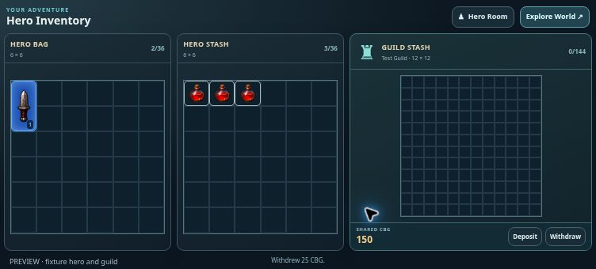

# Shared Guild Stash CBG — v0.0920

Guild members can deposit CBG from their Chess Burger wallet and withdraw shared CBG from Hero Inventory. The compact balance footer and amount dialog fit the existing three inventory panels. This is a separate RPG vault funded by member deposits; it does not expose the guild's scheduled treasury rewards.

The server reads the authoritative wallet, derives current guild membership, and settles both balances, the RPG profile, wallet ledger and transfer receipt in one Postgres transaction. Guild, membership, wallet and profile locks prevent conflicting transfers. Only service_role can invoke the transaction. A stored request ID makes retries idempotent, including a lost reply after a full-wallet deposit. The dialog retains uncertain requests across reopening, and requires explicit confirmation to retry. Battle locks, balance limits and whole-number validation apply. Item transfers preserve the shared currency balance.

Activation: run the complete idempotent `supabase/rpg-guild-stash.sql` once in Chess Burger project `ohaaoiiuaakidttsonxj`. It installs item sharing and CBG sharing together, preserving existing items and balances. No further deployment is required after installation. Public/publishable keys cannot perform this schema setup. The connected Supabase account available during this release exposes another project, so production activation could not be completed from this session. Missing setup now produces an explicit activation message instead of an ineffective Retry button; real connection failures still support retry. Existing item sharing remains usable if only the CBG column upgrade is missing.

Readiness: `/api/profile?feature=rpg&health=1&guild=1` reports `guildReady` for items and `guildCbgReady` for currency. Both must be true before claiming shared storage is active.

Verification: ten database/API checks passed against the actual SQL in PGlite, covering conservation of currency, exact equipment retention, simultaneous withdrawals, receipt replay and mismatches, removed members, insufficient funds, battle locks, limits, server-only privileges and safe installation reruns. Targeted UI checks passed for normal deposit/withdrawal, Cancel, invalid input, lost-response retry with a zero wallet, and missing setup. Browser review at 752×340 and 568×320 confirmed the complete bag, stash and 144-slot guild grid remain visible. A preview deposit changed wallet 1,200→1,100 and guild CBG 75→175; withdrawal of 25 changed them to 1,125 and 150. The screenshot uses fixture data, not a production account.

