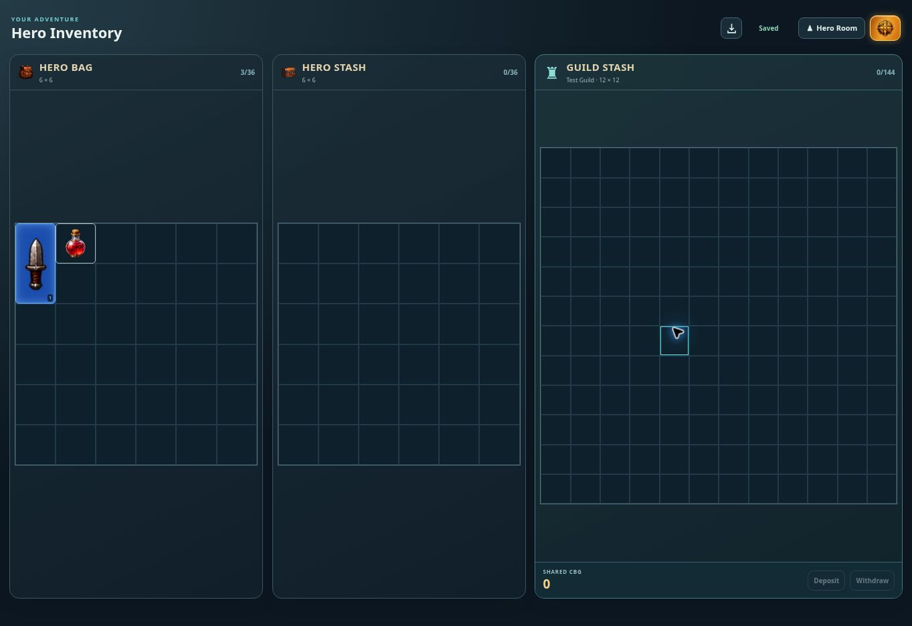

# Immediate guild withdrawal snap-back — v0.1104

Two separate failures were reproduced before this change. Grabbing a tall item near its bottom and dropping into the first destination row produced a negative top-left coordinate. The preview was invalid and the withdrawal never reached a successful transfer. The drop calculation now keeps the entire item footprint inside the destination grid, including moves between the 12×12 guild grid and 6-column personal grids. Occupancy, fit and equipment-level checks still run.

Older potions stored in Guild Stash could retain a flat-20 restore value or obsolete gear fields. Personal inventory migration did not cover those shared items, so withdrawing them failed with `Invalid inventory layout`. Guild snapshots now normalize potion presentation on the client. The server normalizes only the selected cloned potion and commits its conversion in the existing atomic ownership transfer. Failed transfers do not modify shared data; UID and rarity remain intact. Equipment rolls are not regenerated.

Verification: both new regression cases failed before the fix. Twelve guild equipment/CBG checks using real PostgreSQL SQL via PGlite and eleven focused UI checks passed afterward, covering mouse and touch drops, legacy consumables, inventory revisions, idempotency, rollback, level locks and concurrent ownership changes. The production build passed.

A real browser review used a disposable PostgreSQL-backed test inventory and the production UI/service/transfer function. A dagger grabbed near its bottom was dragged into the first bag cell; a legacy potion with an obsolete level requirement was also withdrawn into the bag. After reopening the page, both items remained in Hero Bag, Guild Stash was empty and autosave showed Saved. No authenticated production inventory was changed for this review. Public production health checks are separate from this fixture verification.

