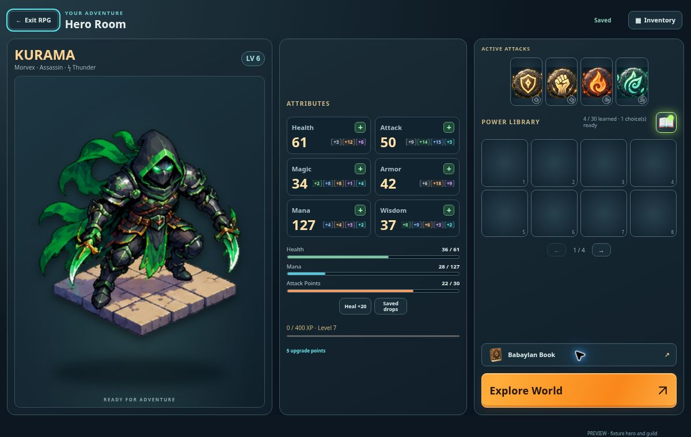
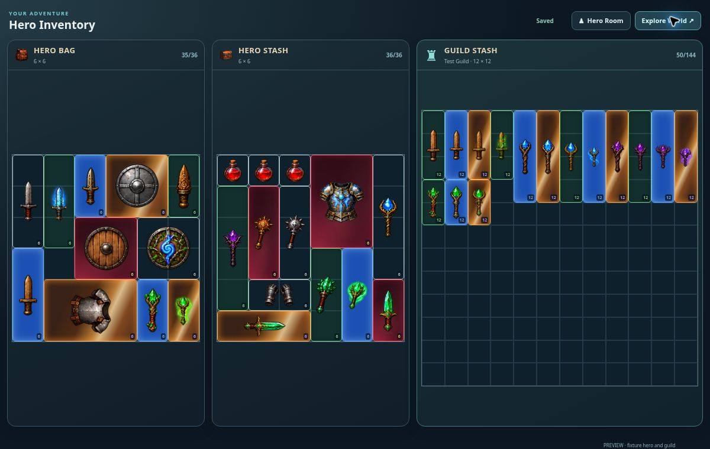
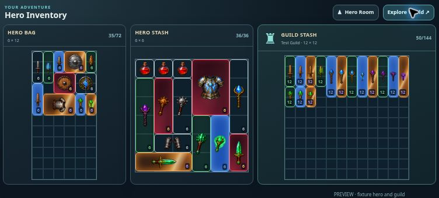

# Hero Room, Hero Inventory and shared Guild Stash — v0.0912

Hero Room presents the existing right-facing full-body hero with a breathing animation, six uniform attribute cards, current HP/MP/AP bars, level and XP progress, active attacks, Power Library, Skill Book and Babaylan Book. Hero Inventory is a separate screen containing only the Hero Bag, Hero Stash and Guild Stash, plus navigation and contextual item interactions. Explorer's bag shortcut returns to Inventory; both screens can resume exploration after inventory saves finish.

Hero Bag starts at 6×6 and retains the merchant's existing upgrades (+12 slots for 488 CBG, at most 36 extra slots). Hero Stash is fixed at 6×6. Larger legacy stashes are repacked on load; overflow keeps its original UID and attributes in saved drops rather than being deleted. Guild Stash is 12×12. Only personal bag equipment contributes to hero attributes.

The guild API derives membership from Chess Burger's cb_guild_members and cb_guilds tables. Deposits, withdrawals and guild-item rearrangements use a single Postgres transaction with guild/profile locks, fresh membership validation, profile and stash revision checks, battle locks and idempotent request receipts. Item rolls and UIDs are preserved. Stale personal saves cannot recreate deposited items. Switching guilds requires a refreshed snapshot before transferring. Snapshots refresh every eight seconds only while Inventory is visible; unchanged snapshots do not replace focused item controls.

Install supabase/rpg-guild-stash.sql in Chess Burger's Supabase project ohaaoiiuaakidttsonxj before enabling production transfers. It adds two server-only RLS tables and a SECURITY INVOKER transaction function restricted to service_role. Anonymous and authenticated roles have no direct access. The public connection settings do not provide schema administration. The connected Supabase account in this session exposes a different project's database, so this installation must be completed through the correct project connection or SQL Editor. The live readiness probe is /api/profile?feature=rpg&health=1&guild=1. No migration was applied to the unrelated project.

Verification: 20 backend checks and 30 UI checks passed, including actual PGlite execution of the installation SQL and transaction, membership removal, guild switching, stale writes, retry receipts, battle locking, legacy overflow, unchanged item enhancements, merchant upgrades, autosave, skill selection and Explorer return flows. Existing battle tests now use a controlled level-1 opponent where the test requires survival, instead of depending on the recently widened random spawn range. Production build passed.

Real-browser review used fixture account/guild data with the actual RPG interface, API service and a test database adapter. Deposit and withdrawal changed stash counts 36→35→36 and guild counts 50→51→50 with exactly one owned copy afterward. The screens were inspected at 1200×760, 1024×768, 752×340, 568×320 and 375×812. A fully upgraded 6×12 bag and the 12×12 guild grid remained wholly inside their panels with square cells on a 752×340 viewport. Babaylan Book opened and closed successfully. Existing live RPG orientation behavior is retained.

