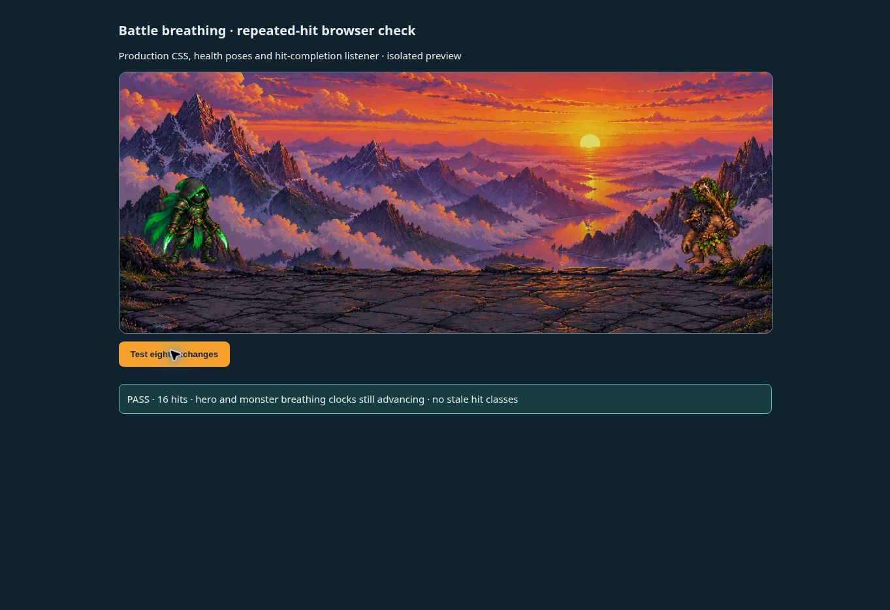

# Battle idle recovery — v0.1224

Hit reactions left `bt-impact-reaction` on both fighter wrappers. Its finite animation replaced the infinite breathing animation, so a living hero or monster could remain still after being hit.

Living fighters now run breathing and the brief hit reaction together. The hit class clears on its matching animation-end event, with a cancellable 300ms fallback when the browser misses that event. Restarting a reaction cancels its previous cleanup timer; closing or cancelling the presentation removes reactions and timers. Death poses keep their finite collapse and remain still afterward. Reduced-motion behavior is retained.

Verification: three focused battle UI checks and 13 health/renderer checks passed. The regression runs eight actual battle exchanges (16 impacts), intentionally omits selected animation-end events to exercise fallback cleanup, checks that both living fighters keep breathing, and finishes with a monster death. A separate real-browser fixture using the production CSS and extracted reaction helpers also passed 16 impacts; both breathing clocks continued advancing with no stale reaction classes. The browser fixture uses isolated test actors, not a production account. Production build passed.

