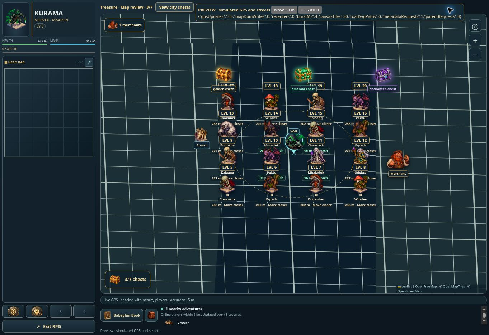

# RPG map performance and 45-degree camera — v0.1072

The ground map now uses an orthographic 45-degree camera. The Leaflet container is enlarged vertically before projection to fill the viewport without empty bands. Hero, player, monster, merchant and chest artwork is counter-scaled around each marker's ground anchor, retaining upright proportions and the actual GPS tap coordinate. Attribution remains readable. Default zoom is 17, with manual zoom and centering available. Drag inertia is disabled so release does not overshoot under the projected coordinate system.

The basemap uses retina-aware canvas tiles, capped at 2x backing resolution, instead of an SVG element for every road. Roads are still redrawn as vectors at the current zoom. Metadata requests are shared and retryable after failure; sibling display tiles share decoded parent tiles. Only water and transportation layers are retained, with feature bounds indexed once per decoded parent. Panning defers new tile rendering until idle. Metadata starts warming while GPS resolves, and tiles are first requested for the user's position instead of an initial default city.

Stationary GPS refreshes reuse the map and pins. Recenter occurs after five meters of movement, an explicit center action, or restoring the minimum zoom. A ResizeObserver replaces repeated size invalidation. Monster rendering skips identical snapshots, checks expiry, and still updates distance/reach when GPS moves. Presence updates reconcile existing player rows and pins. Bag and skill markup is replaced only when its content changes. Background monster discovery is paused; the existing freshness checks, range validation, server spawn behavior, recovery and presence schedules remain in place.

Verification: two basemap checks cover shared metadata/parent requests, filtering, retina resolution, vector reprojection and retry. Eight focused UI checks cover stationary work, upright marker wrappers and click targets, GPS freshness, distance labels, battle GPS pause, encounter previews, returning from inventory and city changes. Production build passed.

Browser review used simulated GPS, streets and API responses, without a production account. In a burst of 100 stationary fixes with 16 monsters, the previous code made 5,400 map DOM mutations and 100 recenter calls; the new code made zero of either. The new renderer used canvas tiles with zero road SVG paths. Sprites with 75px layout height retained a 75px visible height despite the ground projection. A 70x50px drag produced approximately 70x50px screen displacement, and an upright monster opened its matching encounter. An 844x390 phone frame had no page-width overflow and displayed its full 180x180px bag. These are controlled rendering checks, not a production GPS/network latency or frame-rate guarantee. The external tile provider could not be fetched from the executor (HTTP 403); provider data delivery was therefore not part of the browser fixture.

