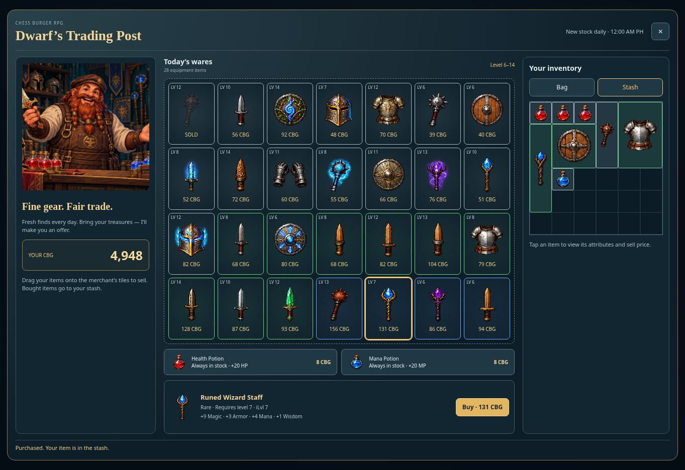

# Dwarf merchant and daily Home reminders v0.0672

Hero Room now opens Dwarf’s Trading Post, with 28 equipment offers and unlimited health/mana potions at 8 CBG. Daily offers cover the hero level at first visit through level +8 (capped at 88), with 15 Common, 9 Uncommon and 4 Rare items. Stock refreshes at midnight Asia/Manila; equipment sells once per account per day. Mobile landscape uses two swipeable rows for larger item icons.

Price is calculated from item level, base-stat budget, extra attribute count and strength, enhancement, rarity, variant tier and weapon/armor category. Sale value is 25% of the calculated buy price, rounded down with a minimum of 1 CBG; potion sale value is 2 CBG. Purchases go to the stash and fail without charging when there is no space. Owned items can be sold from bag or stash by dragging onto merchant tiles or using the detail panel.

Real CBG comes from cb_profiles.gold_points. The server validates ownership and calculates all offers/prices. The service-role-only cb_rpg_merchant_trade function locks wallet and RPG profile, checks revision and active battles, and commits wallet, inventory and ledger atomically. Request IDs prevent duplicate charges. Client inventory saves cannot forge wallet balances. The main app refreshes the account profile after a successful trade.

**Production activation:** apply `supabase/rpg-merchant-store.sql` in the existing Chess Burger Supabase project (`ohaaoiiuaakidttsonxj`). The connected Supabase account currently exposes another project and denied access to this one, so this SQL has NOT been installed by this release. Browsing works before installation; purchase and sale controls remain disabled until the readiness probe succeeds. No credentials or new database projects are needed. `GET /api/profile?feature=rpg&health=1&merchant=1` reports readiness without changing balances.

Home quest, rewards and Arena reminders persist as shown per signed-in account/browser/day, using Philippine calendar dates. Automatic reopening does not replay a reminder already shown that day. The News button intentionally replays reminders on demand; the lifetime Level 3 reminder remains separate.

Validation: 52 RPG/reminder tests passed, including the actual SQL function in PGlite, retry/rollback/permissions checks, and a DOM buy/drag-sell flow. Final SQL readiness tests passed again. Browser QA covered desktop purchases, gear sold-out state, drag-to-sell and 844×390 landscape. Production build passed. No real-user CBG was spent during verification; production trading remains unverified and disabled pending SQL setup.

## Artwork

Built-in image generation produced the new medium-shot dwarf graphic. Final asset: `/workspace/chess-burger-production/public/rpg/assets/merchant/dwarf-merchant.webp`. Original generated PNG retained at `/workspace/scratch/11e1a4629bcf/generated_images/exec-c3f31ea3-2a10-43e9-80e6-f8aedcc140a0.png`. The project WebP is a format conversion preserving the artwork.

Prompt: “Use case: stylized-concept. Asset type: Chess Burger fantasy RPG merchant shop portrait, landscape 3:2. Primary request: a cheerful stout dwarf merchant happily selling weapons, armor, red health potions and blue mana potions, medium shot waist-up behind a wooden shop counter. A friendly smiling dwarf with braided auburn beard, leather apron, simple merchant cap, expressive eyes, one hand presenting a small ornate sword, the other open in welcome. Dark teal fantasy shop interior, warm golden lantern light, shelves with helmets and staffs softly behind him. Polished detailed fantasy pixel-art illustration with crisp textured pixels and rich shading, consistent with an isometric fantasy RPG, readable cheerful character silhouette. Center the dwarf with head and hands fully visible; no cropping of head or sword. Palette dark navy teal, warm copper, antique gold. No text, no logos, no UI, no watermark. This graphic will be used as the RPG shopkeeper portrait.”

