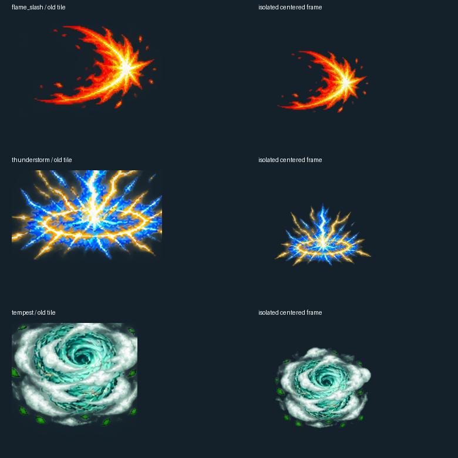
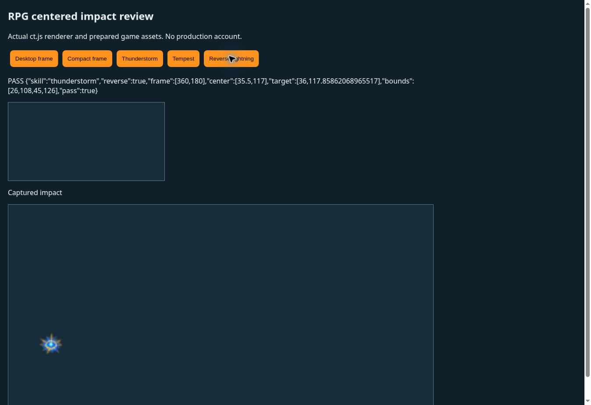

# Equipment merging and skill impact frames — v0.1184

Equipment merges now succeed for server rolls below 0.65. The chance is not displayed in the forge UI or returned as a probability field. Fees, atomic wallet/inventory receipts, safe retries and ingredient preservation on failed attempts keep their existing behavior. Potion recipe and ordinary stacking rules retain their existing behavior.

Common and Uncommon equipment merges produce Uncommon or Rare results; Rare inputs stay Rare. Successful results in those two tiers always receive 2–6 additional, distinct stat bonuses in `forged.attributes`, independently of their normal rarity bonuses. Existing curse rolls still apply. Higher-tier inputs retain the previous no-downgrade upgrade and effect rules. Both inventory validators now accept up to six equipment forge bonuses, and client saves still cannot forge or edit those bonuses.

Skill source artwork previously crossed the rigid 6×6 atlas grid, which cut lightning tips and wind trails. The deterministic exporter now assigns whole connected artwork islands to their source frames and packs each skill into its own six-frame WebP. Visible pixels are centered in 512×512 tiles with at least 160 pixels of transparent padding on every edge. One scale per skill preserves the growing impact animation. Existing artwork is reused without redesigning characters or effects.

ct.js loads the isolated atlases, sets the sprite and texture anchors to (0.5, 0.5), and uses visible-art geometry to constrain effects at both travel endpoints and the vertical impact center. This avoids cutting effects at the canvas edges. Skill atlas textures are evicted with their frame cache to bound memory use.

Validation: 64 forge, atomic-fee, combat, renderer and frame checks passed; six focused live UI checks passed; the source-adapter check and production build passed. Checks cover the exact success boundary, all 2–6 bonus counts, high-tier preservation, ingredient rollback, hidden chance text, 180 centered padded frames, crossing-grid extraction and impact bounds at four viewport sizes. A browser using the actual ct.js bundle passed desktop lightning, compact wind and reverse compact lightning checks, with visible impact centers within two pixels of their targets. No production wallet or player account was used for QA.

