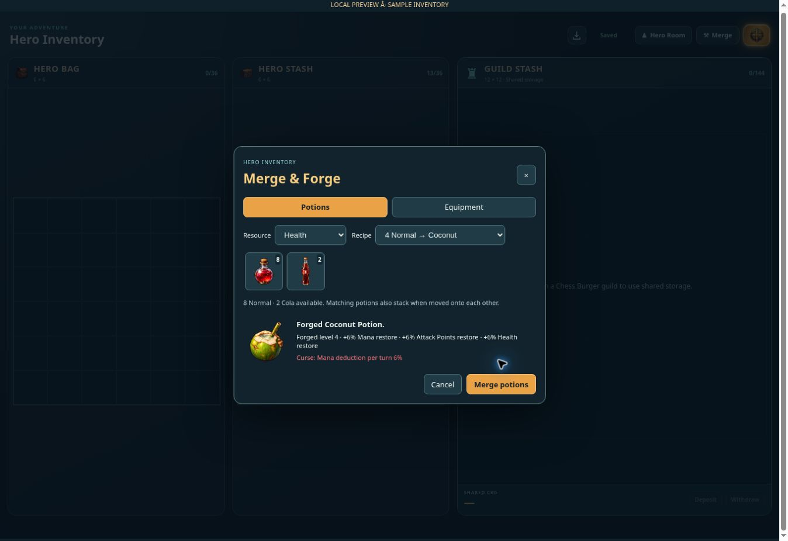
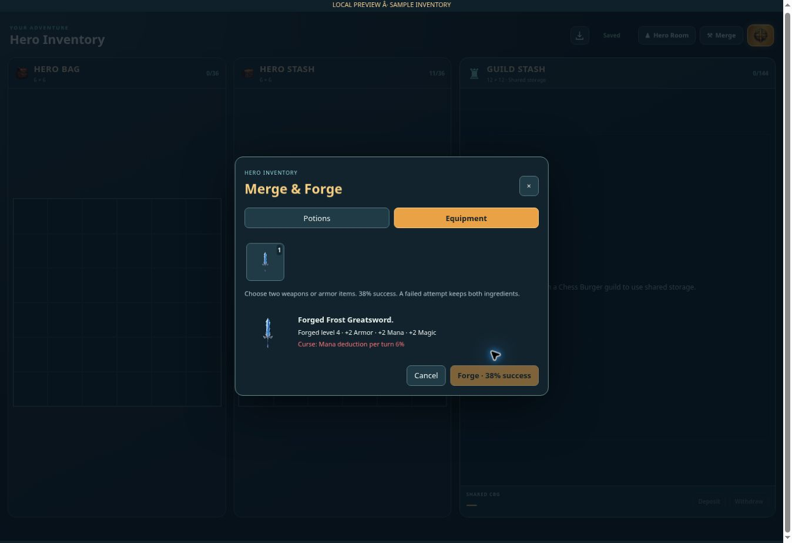

# Potion stacks and item forging — v0.1160

Hero Inventory now has a Merge control and selected owned items have a Merge / Forge action. The responsive dialog supports Health, Mana and AP potion families. Recipes are two Normal for Cola, four Normal for Coconut, two Normal plus one Cola for Coconut, and ten Normal for Tuba Wine (or the matching resource-family tiers).

Identical potions with matching rarity and forged effects stack per container, up to 999 units, with a top-right quantity counter. Dropping one compatible stack onto another combines them. Purchases and loot can use existing stacks. Hero Room, online battles, offline replay and PvP consume one unit per use. Merchant sales explicitly quote and sell the entire selected stack. Ordinary consumables remain free of equipment bonuses.

Potion upgrades succeed when the recipe and output space are available. They roll a higher forged level up to 88. Optional potion bonuses restore an extra 2–8% of two or three distinct maximum resources on use; curses taken outside combat are queued for the next battle. Equipment forging consumes two owned items only on success (38% chance); failures keep both ingredients. Same-item forging can retain the original definition, create a merge-only sword, or produce another ordinary weapon. Different-item forging can produce random equipment. Equipment item level increases by 1–4 and rarity never falls below the strongest input (minimum Rare, upgrade up to two rarity steps).

The overlapping outcome probabilities are represented as 10% curse only, 50% bonuses only, 20% both and 20% neither: 30% curse overall, 70% added bonuses overall and 20% overlap. Equipment receives two or three distinct stat bonuses when selected. Curses are life drain, poison, mana deduction or skipped turns, shown in red. They affect the owner while equipped or for the battle after a forged potion is consumed. Turn skips use deterministic accumulated percentages so offline replay and the server agree. Combined curse percentages cap at 20% per type. Battle curse events resolve in order without replacing attack animations.

Eight four-slot merge-only swords have separate padded WebP sprites. They are excluded from normal monster drops, chest loot and merchant stock. Their prompts, built-in generation mode and paths are recorded in rpg-merge-weapon-art-v1160.json.

The API checks ownership, inventory revisions and battle locks. Request receipts prevent a retried merge from consuming ingredients twice. Quantity-conserving rearrangements are accepted, while new quantities and forged attributes cannot be submitted through inventory saves. Active PvP potion receipts are retained beyond 200 uses to prevent repeat debits. Existing JSONB inventory storage is used; no database migration is required.

Verification: all 261 RPG tests passed, including recipe/probability boundaries, full-inventory rollback, potion quantities, offline and PvP reuse, long-battle receipts, JSONB saves, guild transfers, chest recovery, curse turn order and isolated sprite geometry. Production build passed. Browser review with a clearly labeled sample inventory confirmed four Normal potions becoming one Coconut potion (12 → 8 remaining), a higher forged level, red curse details, and a Frost Greatsword produced from two matching weapons. No production account was used for browser QA.

