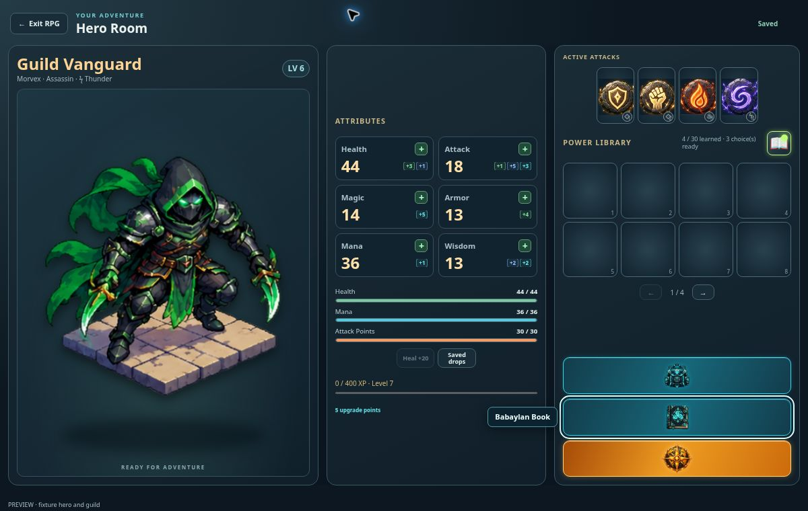
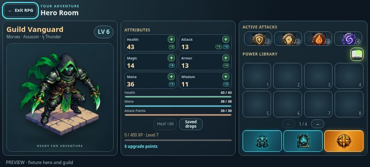

# RPG navigation and quicker Guild Stash transfers — v0.0928

Hero Inventory, Babaylan Book and Explore World now share matching icon-only button frames in the Hero Room's right panel. Inventory and Babaylan Book use electric cyan; Explore World uses an animated golden-orange glow. Labels appear on hover or keyboard focus, and each button retains an accessible name. The three actions form a vertical stack on larger landscape screens and a compact row with 44-pixel-high targets on phones. The Inventory screen's Explore World shortcut uses the same artwork and glow. Hero artwork and the existing room destinations are preserved.

Item transfers render an immediate, visibly pending preview. Unconfirmed ownership is never written to the hero's save or used to change attributes. Only equipment interactions and exploration are locked during confirmation; Hero Room navigation and Babaylan Book remain available. Success applies the authoritative transaction response without another snapshot request. Failure restores the confirmed layout and reconciles personal and shared inventories, including a lost reply after the server committed.

The server reads guild details and the stash concurrently after membership lookup, and reads the transfer receipt alongside the snapshot. Read-only stash refreshes skip loading/normalizing the hero and bypass the mutation request queue. A response epoch prevents older background snapshots from overwriting newer transfers or CBG balances. Existing SQL membership checks, locks, revision checks and receipts remain authoritative. The live database reports both guildReady and guildCbgReady true; this release requires no SQL changes. Network confirmation time still depends on the connection, while the visible item move starts immediately.

Validation: 11 Postgres/API checks, 36 UI checks and the Postgres JSONB inventory regression passed. New cases cover immediate previews, no premature persistence, failure recovery before/after commit, and delayed background snapshots. The harvest replay test uses a controlled level-1 enemy so random high-level damage cannot end the battle before the modal assertion. The production build passed. Browser review used fixture accounts at 1200×760, 752×340 and 568×320: equal button frames, contained artwork, focus labels, book open/close, successful item transfer with exactly one copy, unchanged shared CBG, and complete inventory grids without page overflow.

## Artwork

Generated with the built-in image_gen tool using the user's exact selected, annotated Hero Room screenshot as the edit source. Each logo was generated separately on transparent alpha, then optimized to a 256×256 WebP for the application. Original hero sprites were not changed.

Saved assets:

- `public/rpg/assets/navigation/explore-v2.webp`
- `public/rpg/assets/navigation/inventory-v2.webp`
- `public/rpg/assets/navigation/babaylan-v2.webp`

Final prompt set: Use case precise-object-edit. From the exact supplied Chess Burger Hero Room screenshot, redesign and isolate only the requested button symbol as a standalone production game UI asset. Return the replacement emblem only, without the screenshot or annotations. Use professional solid glossy fantasy RPG styling, sculpted relief, a clean silhouette, restrained luminous rim, readability at 32–64 pixels, and the existing glossy rune aesthetic. Center one upright emblem on a square transparent canvas, with generous transparent padding, crisp edges and a frontal view. Exclude text, letters, watermark, button frames, floor, tiled pedestal, extra items, edge-clipped shadows, red annotations and screenshot background.

Per-asset subjects:

- Explore World: polished golden-orange compass over a stylized globe, broad compass points, ember-gold center, warm edge light, golden orange/amber with dark enamel recesses.
- Hero Inventory: polished fantasy adventurer backpack with a clear flap and buckle silhouette, electric-cyan seams on midnight-teal metal/leather, cyan/turquoise with dark enamel recesses.
- Babaylan Book: polished ancient closed magical book with readable spine/pages, a centered electric-cyan cover rune, small cyan clasps and a midnight-teal cover, cyan/turquoise with dark enamel recesses.

