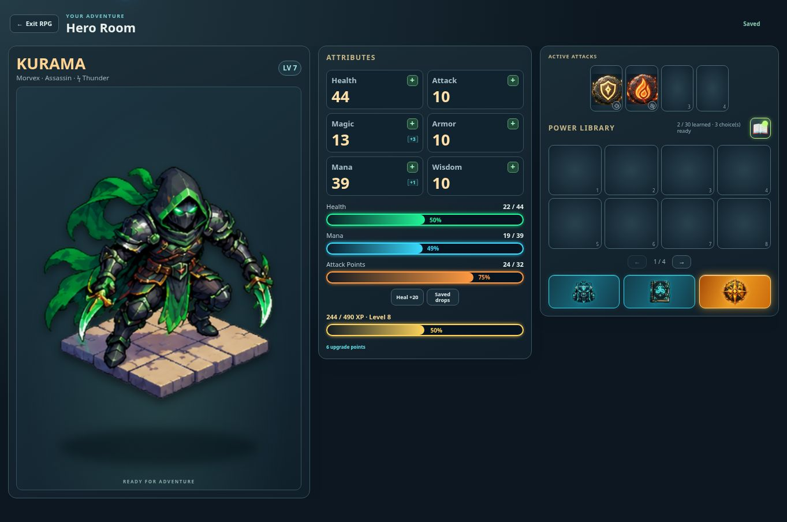

# Hero Room neon status bars — v0.0968

Health, Mana, Attack Points and level progress use the supplied rounded neon-outline design. Health is green, Mana cyan, AP orange and XP gold. Gradient fills use exact current/max ratios; whole percentage labels follow the fill edge while exact resource totals remain above. A dark backing keeps percentages readable over bright fill. XP retains its native progress element and resource meters retain their accessible current/min/max values. Reduced-motion preferences disable fill transitions.

The Hero Room uses 21-pixel bars on larger screens, 16 pixels in compact landscape and 14 pixels on the shortest landscape phones. Small-screen attribute spacing is tightened so all four bars and remaining upgrade points fit without clipping. Other RPG screens retain their existing presentation.

Verification: three focused live UI checks passed, covering real potion updates, empty health, capped resources, maximum-level XP, Skill Book behavior and guild inventory navigation. Browser review used an isolated fixture hero and confirmed the desktop layout, 752×340 and 568×320 landscape layouts and 390×844 portrait layout. The smallest attribute panel had equal client and content heights (253px), with the final upgrade row inside its bounds. The portrait page had no horizontal overflow. Production build passed.

