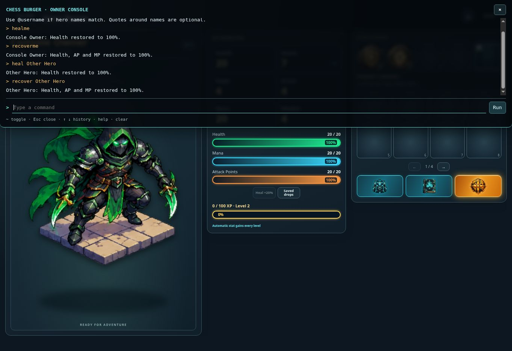

# Owner recovery console — v0.1200

Press `~` (the backquote key also works) inside RPG to open a translucent black terminal at the top of the screen. Escape, the close button or the same key closes it and restores keyboard focus. The input supports Enter, Up/Down command history, `help` and `clear`.

Commands: `healme` restores the owner's hero Health to its equipped maximum; `heal <hero name>` does the same for another hero. `recoverme` and `recover <hero name>` restore Health, AP and MP to their respective equipped maxima. Multiword names work with or without quotes. Name matching is exact and case insensitive; duplicate names fail safely and can be disambiguated with `heal @username` or `recover @username`.

Opening and executing both use the existing authenticated RPG API. The handler verifies the access token with Supabase and reads the current `cb_profiles.role`; only `owner` passes. Neither client flags nor user-editable metadata grants access. Input uses a strict command parser, with no JavaScript or SQL execution. Name patterns are escaped. Writes retain the existing profile revision checks, command request IDs prevent duplicate application, and successful commands create `rpg_owner_recovery` audit entries in `cb_admin_logs`.

Active server battles update only the selected combatant and do not consume a turn. Local monster battles receive one-use recovery grants stored in the server encounter. The device journals those grants, and server replay rejects fabricated or repeated grants. Commands issued after a device already finished are retained when its result settles, without changing its winner. Other heroes refresh recovery status while RPG is open, normally every eight seconds; active presentations finish before the correction is displayed. Recovery does not change equipment, XP, currency, cooldowns or potion curses. Commands require a connection.

Verification: 19 owner/recovery/offline/reset checks and two focused UI checks passed. The browser fixture exercised all four commands through a real local HTTP service using the production request/store logic. `healme` changed HP from 0/20 to 20/20 while MP stayed 2/20 and AP stayed 1/20; `recoverme` then set all three to 20/20. Both named-hero commands succeeded. The dialog was full width at y=0 with an rgba black background. This used test heroes rather than production player accounts. The production build passed.

