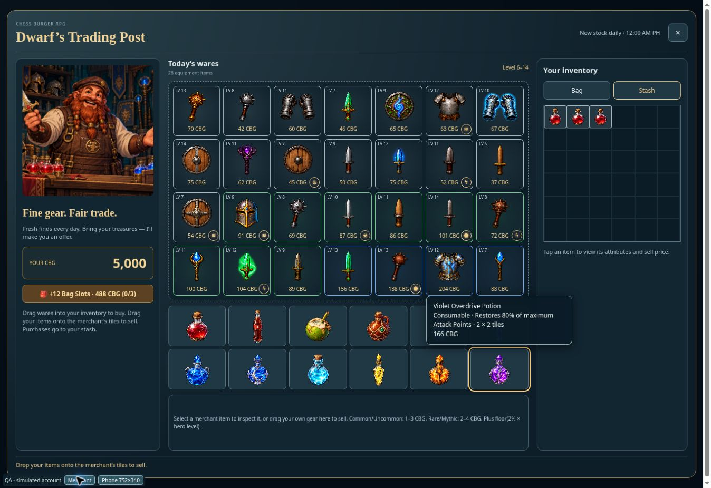

# Sprite-only merchant potions — v0.1040

All twelve merchant potion buttons now show only their existing sprites, enlarged within the tile. A tooltip reveals the potion name, resource percentage, footprint and CBG price on pointer hover or keyboard focus. Selection still opens the purchase details and quantity controls, including on touch screens. Tooltips clear on selection, blur, close or resize; keyboard focus remains visible when the horizontal mobile row scrolls.

The merchant UI check passed for sprite-only DOM content, pointer and keyboard tooltip lifecycle, scrolling, purchases, quantities, drag-to-buy and selling. Browser review confirmed all twelve images loaded without inline labels, and the focus tooltip stayed inside both desktop and 752 × 340 viewports. Preview used a simulated account and wallet. Production build passed.

