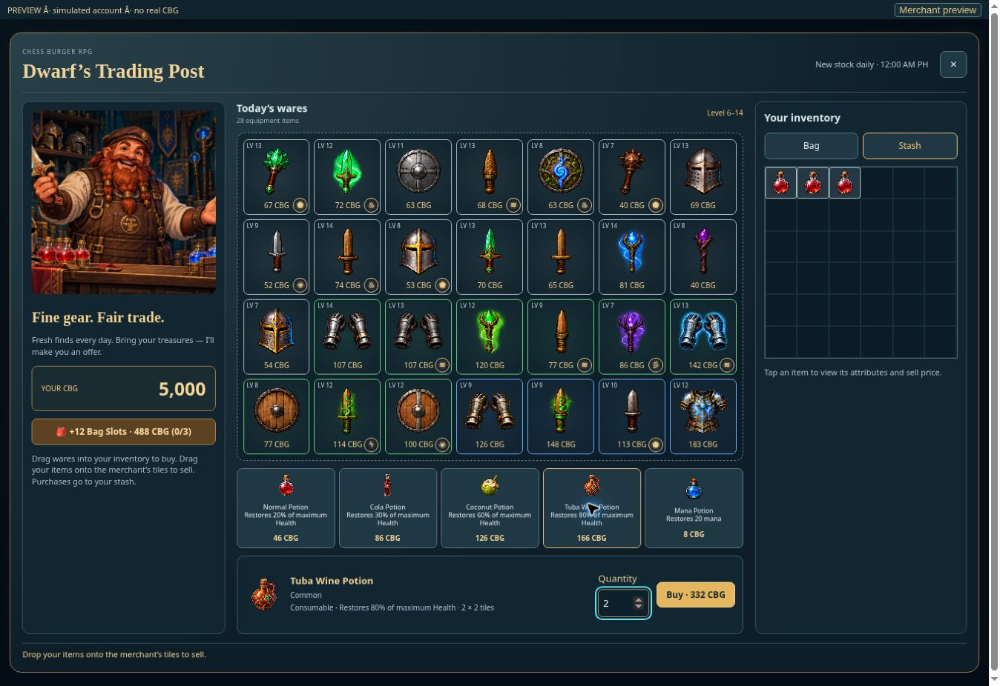

# Four health potions — v0.1024

| Potion | Restores maximum Health | Bag footprint | Merchant CBG price | Monster drop chance |
| --- | --- | --- | --- | --- |
| Normal | 20% | 1 × 1 | 40 + current hero level | 80% |
| Cola | 30% | 1 × 2 | 80 + current hero level | 40% |
| Coconut | 60% | 2 × 2 | 120 + current hero level | 30% |
| Tuba Wine | 80% | 2 × 2 | 160 + current hero level | 10% |

Each health potion has an independent roll after a monster victory, so several types may drop together. Those rolls replace the old random flat-health potion slots; equipment and mana selections retain their existing rules. Health drops are common consumables without equipment attributes, enhancements or level requirements. Mana potions retain their 20-point effect and 8 CBG price.

Healing uses the equipped maximum Health, rounds to whole points, applies existing potion-effectiveness equipment bonuses, and stops at full Health. Hero Room consumption, battle drag/drop, online PvP potion turns and local monster battle replay share the same catalog. Battle consumption still uses one turn. Merchant quantity prices use the current hero level even if daily gear stock was generated at an earlier level. Purchases must fit the stash and preserve atomic wallet settlement and retry receipts.

Existing health-potion UIDs and positions are retained while their saved effect migrates to the Normal Potion percentage. Canonical effect comparison is independent of JSONB key order. Sprites are separate transparent WebPs, 18–33KB each, with padded edges. Their built-in image-generation prompt set and paths are recorded in rpg-potion-sprites-v1024.json.

All 51 checks passed (46 service/inventory checks and five focused UI checks), and the production build passed. Coverage includes potion footprints/rotation, percentages and caps, independent drop boundaries, level-based pricing and quantities, full-stash rejection, migration, JSONB round trips, guild inventory, online potion turns, offline replay, owned-item debit and duplicate settlement. Browser review used the real frontend with a simulated account: the bag showed all footprints and the merchant showed prices 46/86/126/166 CBG for a level 6 hero. Selecting two Tuba Wine Potions displayed 332 CBG. No production account or wallet was used for QA.

