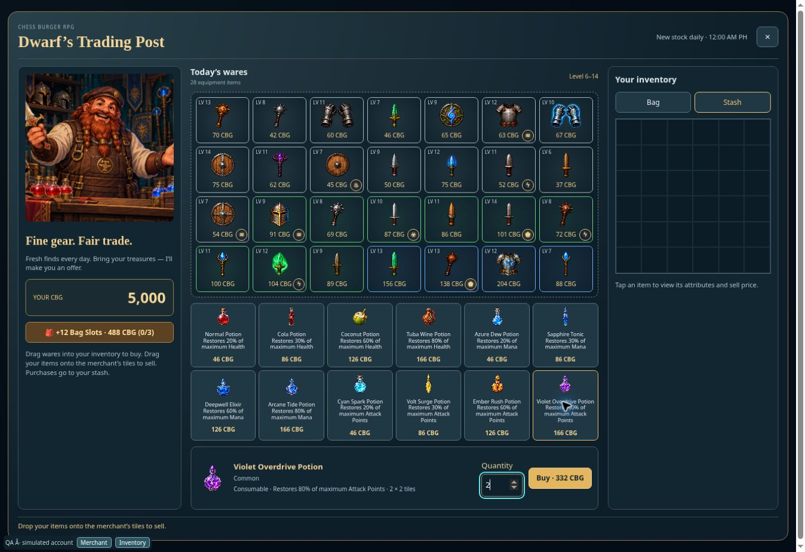
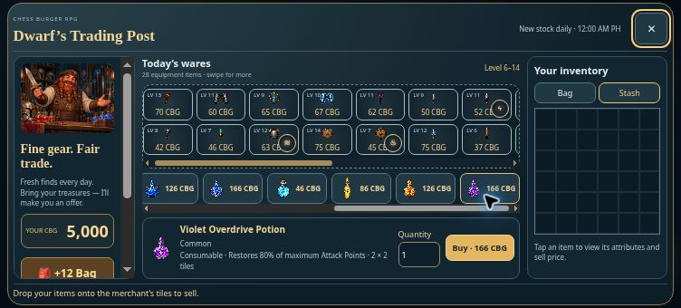

# Mana and Attack Points potions — v0.1032

| Restores maximum resource | Mana potion (blue) | AP potion | Bag footprint | CBG price | Independent monster drop chance |
| --- | --- | --- | --- | --- | --- |
| 20% | Azure Dew Potion | Cyan Spark Potion (electric cyan) | 1 × 1 | 40 + hero level | 80% |
| 30% | Sapphire Tonic | Volt Surge Potion (electric yellow) | 1 × 2 | 80 + hero level | 40% |
| 60% | Deepwell Elixir | Ember Rush Potion (electric orange) | 2 × 2 | 120 + hero level | 30% |
| 80% | Arcane Tide Potion | Violet Overdrive Potion (electric purple) | 2 × 2 | 160 + hero level | 10% |

Both families match the existing health potion tiers. All twelve potion types roll independently after monster victories; the old random mana slot is replaced by these percentage rolls to avoid duplicate base-potion drops. Equipment rolls retain their existing selection. All potions are consumables without equipment enhancements or level requirements. Existing potion-effectiveness equipment bonuses apply, percentages use the equipped resource cap, and restoration stops at the maximum.

The shared catalog drives merchant prices, quantity totals, descriptions, footprints, inventory validation, Hero Room use, PvP turns and local battle replay. AP consumption uses the same one-turn rule as Health and Mana. Saved AP now carries into a new encounter, matching the persistent AP meter and allowing Hero Room AP restoration to matter. Existing mana potions retain their item IDs, UIDs and coordinates while their effect migrates from 20 flat points to 20% of maximum Mana. Full resources reject consumption without deleting the item.

Eight sprites were generated separately with the built-in image generator, then packed as transparent WebPs with isolated padded edges: 256 × 256, or 256 × 512 for tall 1 × 2 potions. Each is below 100 KB. Prompts, source files and final asset paths are recorded in rpg-potion-sprites-v1032.json.

Validation covers each tier's prices, drop boundaries, footprints, cap handling, migration and JSONB round trips, owned-item consumption, one-turn PvP use, offline replay and retry settlement, full-stash purchase rejection and no duplicate charges. Browser review used a simulated account and wallet with the actual frontend and service: all twelve merchant images loaded, level 6 prices were 46/86/126/166 CBG, and two Violet Overdrive potions totalled 332 CBG. At 752 × 340, the potion row scrolls horizontally and the selected potion's quantity and Buy controls fit within the dialog. No production account or wallet was used for browser QA.

