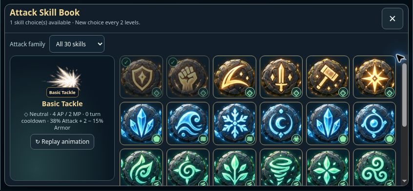

# Mobile Attack Skill Book — v0.0960

The Skill Book now has a viewport-bounded card with a fixed header and category controls, plus an independently scrolling rune grid. Short landscape screens place the compact animation preview beside the grid; portrait phones use four columns. Rune artwork is constrained to square buttons, and explicit content-sized grid rows prevent overlap or cropping between rows. The close control remains 44 × 44 pixels. Learned checks and element badges occupy separate corners. The opening note is shortened and the animation implementation status is hidden.

Browser review used the actual built RPG page, a fixture hero and the managed preview; no production account was modified. Verified 844 × 390 and 740 × 320 landscape, 390 × 844 and 320 × 568 portrait, 1024 × 768 tablet and 1366 × 768 desktop. No intersecting rune buttons or horizontal grid overflow were found. The smallest measured portrait tile was 62 pixels. The family filter returned six Fire skills, the final Thunderstorm rune was reachable at the end of the scrolling grid, and selecting then cancelling preserved the available skill choice. The existing Skill Book activation/cancellation UI check passed.

