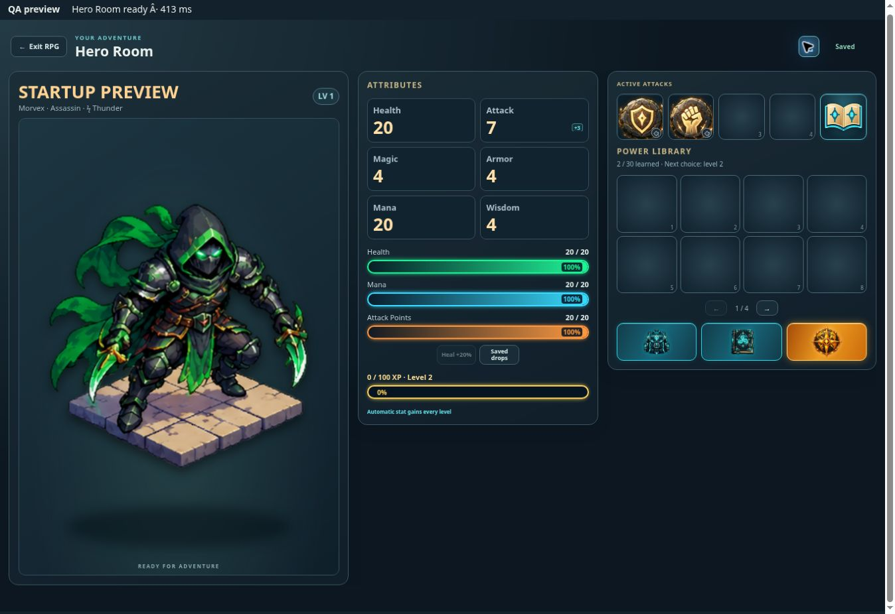

# RPG opening payload and recovery — v0.1128

The live v0.1120 RPG opening document contained 10,224,400 bytes of HTML and JavaScript, including 9,694,392 bytes of inline image URLs. Its compressed response was 7,473,177 bytes. Hero, item and Babaylan artwork was bundled into every opening even when those views were closed. This is a confirmed startup bottleneck; the reported ten-minute delay was not reproduced on the developer connection.

The build now extracts those original image bytes into 111 deduplicated, content-hashed static files. Runtime catalogs retain the same keys and artwork but reference individual files. The opening document is 539,424 bytes, or approximately 140 KB gzip: a 98% reduction in the mandatory compressed HTML payload. Images load as their views request them and remain in the optional device pack. Content-hashed images have immutable browser caching; the existing revision-based device cache also retains them. Original source artwork and identity hashes remain intact.

The parent RPG portal requests its versioned entry page so an older service worker cannot silently return the old large HTML after an app update. A matching worker still serves its cached revision. An opening that stalls before the account handshake now shows Retry after 30 seconds and offers Back to Chess Burger immediately. The existing account initialization request retains its separate bounded timeout.

Verification covers byte-for-byte artwork identity, all generated image references and optional pack entries, compressed opening-size budget, stale-versus-current worker handling, download/cache behavior, timeout/retry/handshake rendering, hero creation and reopening, all eight hero identities, and merchant inventory. In a real-browser controlled preview, Hero Room opened in 413 ms using an in-memory test account API; the inventory and a Babaylan monster page then loaded their original artwork. This measurement excludes production authentication/database and mobile-network latency. No production account was used for browser QA.

