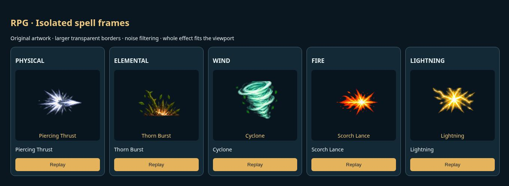

# RPG map, exit, loot and spell frames v0.0664

Exit RPG closes the iframe and selects Home with the welcome overlay hidden, regardless of its entry portal. It does not reload the app.

Returning from the bag immediately redraws the last known hero position and still-valid fixed monster pins, while requesting fresh GPS and encounter data. Cached coordinates are marked as updating and never made artificially fresh. Every 10 seconds the map checks layout, redraws hero/monster overlays, and refreshes stale GPS; player presence retains its 8-second sync. Transient GPS errors preserve last-known pins. Permission denial still stops GPS. Pinned monsters retain their original expiry.

Loot now rolls 85% equipment and 15% health/mana potions independently for every drop. The 1–3 drop count and separate 85/10/5 Common/Uncommon/Rare chances remain. Weapon/armor category is selected once per drop. Equipment uses the original sandbox roll rules, random level requirements, enhancement and rarity attributes. The main catalog's 68 equipment variants and item sprite data match the original sandbox exactly, confirmed by hash comparison. Existing items and potion behavior are preserved.

ct.js uploads individually isolated 512×512 frames containing at most 144×144 artwork (over 71% transparent width/height allowance). Integer source boundaries prevent fractional sampling. Faint alpha noise and disconnected noncentral edge fragments from neighboring rows are removed before upload. Central effects and their connected trails are retained. Animation size fits the battle bar and library preview. The supplied source sheets are unchanged.

Validation: 48 RPG regression tests passed, including bag-return marker/presence restoration, independent loot type boundaries, frame cleanup, and sandbox equipment parity. Five spell groups were checked in a browser. Production build passed. Authenticated production gameplay and the main app's signed-in exit path are not browser-tested; exit routing is verified in source and the production build.

